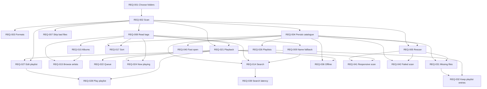

# LocalShelf product backlog

Initial requirements elicitation for the CEN4020 term project. Version 0.1, 9 October 2026.

This document is the product backlog after one elicitation pass. It is the input to later sprint planning. It is not a design, a test plan, or a commitment of story points. Estimates stay off the items until the backlog has been discussed.

The structured copy of the same items, including tags and dependency ids, is [`requirements.json`](requirements.json).

## 1. Purpose

Homework 1 asked what problem to spend the term on, and asked for a Scrum or Kanban preference. The author chose Scrum, because a living backlog fits a project whose shape will change as it is built. This pass turns the problem answer into that backlog: tagged requirements, priorities, and dependencies, ready to be pulled into sprints.

The prompt that produced this pass is in [`elicitation-prompt.md`](elicitation-prompt.md).

## 2. Problem

Streaming libraries get clumsy once they are large. The author tried Spotify, Deezer, and Apple Music. On all three, looking up music becomes too slow once the collection passes a few thousand tracks, around 3,000 in the author's experience. Keeping the files locally is the more dependable listening experience. The offline and local modes inside those apps still behave like a cache of someone else's catalogue.

**LocalShelf** is a desktop music library for that situation. The user points it at folders of audio files they already have. It builds a local catalogue, keeps search and browsing quick as the collection grows, and plays those files without an account and without a network connection.

The original answer left the exact feature set open. This pass makes a scoping choice: the product is the local library, not a new streaming service. That boundary is recorded as REQ-038 and the other Won't items, so it stays visible in the backlog.

### What the author stated

- Lookup in Spotify, Deezer, and Apple Music is too slow once a library is large, on the order of 3,000 tracks or more.
- A local copy of the files is a better listening experience than those services.
- The term project should stay on this problem. The precise feature cut was not chosen yet.

### What this pass inferred

- The workable semester project is a local catalogue and player, because matching a streaming catalogue implies service APIs and DRM.
- Fast search needs a persisted index, metadata, and a latency target, or the original complaint has no way to tell whether it was solved.
- Playback, playlists, and a missing-file view are what make the index into a library a person would actually use.
- Artwork, tag writing, smart playlists, and duplicate hashing are useful and can wait.

Items are tagged with a source so those two lists stay traceable: **Problem statement**, **Derived**, **Domain expectation**, or **Scope boundary**.

## 3. Stakeholders and personas

| Who | Role this term | Interest |
| --- | --- | --- |
| Author | Primary user and developer | A large personal collection that can be searched and played from local files |
| Course staff | Reviewer of the backlog and the later system | A traceable, testable backlog with an honest scope |
| Classmates | Later reviewers or users of a demo | A library they can understand in one sitting |

Personas used on the requirements:

- **Collector.** Lives in the author's situation: several thousand files, frustrated with lookup time inside streaming apps, and already convinced that real files on disk are the better library.
- **Listener.** Wants to press play and move through artists and albums. Tolerates messy tags as long as the music plays.
- **Organizer.** Cleans titles, artists, albums, and duplicate copies in a collection that has been copied between disks for years.
- **Any.** The requirement applies to every person using the app.

There is no second end-user interview yet. Confidence on each item records how firmly this pass believes it. High means it comes straight from the problem statement or from a scope decision. Medium means it is a direct consequence or a usual expectation of this kind of product. Low means it is a guess to confirm or cut at the next pass.

## 4. Scope of the first release

Priority uses MoSCoW and is about this term:

| Priority | Meaning in this backlog |
| --- | --- |
| Must | Needed for the first release the term is aiming at |
| Should | In the backlog for a later sprint if the Must set is in good shape |
| Could | Recorded so it is not forgotten; not planned for the first release |
| Won't | Out of scope this term, written down so it does not sneak back in |

The first release is the Must set: choose folders, scan and reopen a catalogue, read tags with a filename fallback, group albums, search while typing, browse by artist and album, sort, play with a queue and a now-playing view, keep playlists, show missing files, and meet the offline, privacy, latency, startup, responsiveness, and failed-scan rules.

### Design point for the performance items

REQ-039 and REQ-040 need a concrete library and machine or they cannot be tested later.

- **Design-point library:** 10,000 audio files, mixed formats from REQ-003, tags present on most files. The author's pain shows up near 3,000 tracks in streaming apps. Ten thousand is the target so LocalShelf still feels fine past that point.
- **Reference laptop:** a machine with an SSD and at least 8 GB of memory, in the class of computer the author already uses. The course machine can replace this definition once it is known.
- **Warm catalogue:** the index from REQ-004 is already loaded, and no rescan is running.

The numeric targets are proposed acceptance bars. They are not measurements.

## 5. Assumptions

1. The user already has audio files and the right to play them. LocalShelf does not acquire music.
2. One person uses the app on one computer. There is no shared login.
3. Decoding may use an existing playback library. Writing codecs from scratch would change the project into a media-engineering effort and is outside these requirements.
4. For this pass, a track's identity is its file path. A stable id (REQ-004) survives restarts for that path. Moving a file looks like a removal plus an addition until a later pass decides otherwise.
5. English is the only interface language in this pass.
6. The first demo can be Windows-first. Other desktop systems are not excluded, and they are not required yet.

## 6. Open questions

These are the decisions this pass refused to invent. The next elicitation conversation should close them.

1. Is 10,000 tracks the right design point, or does the author's collection need the targets restated at 30,000 or 50,000?
2. Is the graded build Windows-only, or does the same catalogue need to open on macOS or Linux this term?
3. Are MP3, FLAC, M4A, Ogg Vorbis, and WAV the right format set, or does the real collection depend on something else?
4. Should album grouping follow embedded tags only, or also a one-folder-per-album layout for rips with weak tags?
5. When the user fixes a tag, is an in-app override enough (REQ-012), or do they need the file itself updated (REQ-013)?
6. When a file moves to a new path, should the rescan try to recognize it as the same track, or is delete-and-add acceptable?
7. Is volume normalization (ReplayGain) part of sounding better than the streaming apps, or is it a later project?
8. Should the play queue survive a restart?

## 7. How to read an item

| Field | Meaning |
| --- | --- |
| Id | Stable backlog id. Do not reuse an id if an item is later dropped; retire it. |
| Type | Functional, non-functional, or constraint |
| Epic | The group of related outcomes |
| Priority | MoSCoW for this term |
| Status | All items are **Proposed**. Nothing here has been confirmed with a second user or a prototype. |
| Confidence | High, Medium, or Low, as defined in section 3 |
| Persona | Collector, Listener, Organizer, or Any |
| Source | Where the item came from, so inferred work stays visible |
| Tags | Topical labels for filtering the backlog |
| Depends on | Other requirements that have to be acceptable before this one can be accepted |

A dependency is an acceptance prerequisite, not a ban on starting the work. A sprint can build a screen early. The item is not done while a requirement it depends on is still open. Every Must item depends only on other Must items, so the first release does not wait on Should or Could work. The Won't items have no dependents.

## 8. Epics

| Epic | Goal | Requirements |
| --- | --- | --- |
| EPIC-01 Library intake | Turn folders of audio files the user already has into a catalogue the app can reopen. | [REQ-001](#req-001-choose-library-folders), [REQ-002](#req-002-scan-folders-for-audio-files), [REQ-003](#req-003-support-common-audio-formats), [REQ-004](#req-004-persist-the-catalogue-locally), [REQ-005](#req-005-reconcile-the-library-on-rescan), [REQ-006](#req-006-show-scan-progress-and-allow-cancel), [REQ-007](#req-007-tolerate-unreadable-files) |
| EPIC-02 Metadata | Give every track a usable title, artist, and album, including files whose tags are incomplete. | [REQ-008](#req-008-read-embedded-metadata), [REQ-009](#req-009-fall-back-to-file-and-folder-names), [REQ-010](#req-010-group-tracks-into-albums), [REQ-011](#req-011-display-cover-art), [REQ-012](#req-012-edit-metadata-without-rewriting-audio), [REQ-013](#req-013-write-metadata-back-to-the-file-on-confirmation) |
| EPIC-03 Lookup and browsing | Find a track quickly once the collection is past a few thousand songs, which is the pain that started this project. | [REQ-014](#req-014-search-the-library-while-typing), [REQ-015](#req-015-browse-by-artist-and-album), [REQ-016](#req-016-browse-by-genre), [REQ-017](#req-017-sort-track-lists), [REQ-018](#req-018-filter-track-lists), [REQ-019](#req-019-show-recently-added-and-recently-played), [REQ-020](#req-020-search-and-browse-during-a-scan) |
| EPIC-04 Playback | Play the local file from the library, the queue, or a playlist. | [REQ-021](#req-021-play-audio-with-transport-controls), [REQ-022](#req-022-keep-an-ordered-play-queue), [REQ-023](#req-023-control-volume), [REQ-024](#req-024-show-now-playing), [REQ-025](#req-025-resume-long-tracks) |
| EPIC-05 Playlists | Let the user organize tracks without depending on a streaming account. | [REQ-026](#req-026-create-and-delete-playlists), [REQ-027](#req-027-edit-playlist-contents), [REQ-028](#req-028-play-a-playlist-in-order), [REQ-029](#req-029-export-a-playlist-as-m3u), [REQ-030](#req-030-build-a-smart-playlist-from-filters) |
| EPIC-06 Library health | Show broken files, thin tags, and likely duplicates instead of hiding them. | [REQ-031](#req-031-track-missing-files), [REQ-032](#req-032-keep-user-data-when-a-file-disappears), [REQ-033](#req-033-flag-incomplete-metadata), [REQ-034](#req-034-suggest-duplicate-recordings), [REQ-035](#req-035-confirm-duplicates-by-content-hash) |
| EPIC-07 Quality attributes and scope | Lock the qualities that make this a local library, and record what this term will leave alone. | [REQ-036](#req-036-work-fully-offline), [REQ-037](#req-037-keep-the-library-on-the-device), [REQ-038](#req-038-leave-streaming-catalogues-and-drm-out-of-scope), [REQ-039](#req-039-meet-the-search-latency-target), [REQ-040](#req-040-open-a-large-library-quickly), [REQ-041](#req-041-stay-responsive-while-indexing), [REQ-042](#req-042-keep-the-previous-index-if-a-scan-fails), [REQ-043](#req-043-leave-multi-device-sync-out-of-scope), [REQ-044](#req-044-leave-social-features-out-of-scope), [REQ-045](#req-045-leave-a-mobile-client-out-of-scope), [REQ-046](#req-046-leave-podcasts-and-video-out-of-scope) |

## 9. Backlog summary

46 requirements: 26 Must, 11 Should, 4 Could, 5 Won't.
By type: 35 functional, 5 non-functional, 6 constraints.
By source: 5 from the problem statement, 12 derived, 24 domain expectations, 5 scope boundaries.

| Id | Title | Type | Priority | Confidence | Source | Depends on |
| --- | --- | --- | --- | --- | --- | --- |
| [REQ-001](#req-001-choose-library-folders) | Choose library folders | Functional | Must | High | Problem statement | — |
| [REQ-002](#req-002-scan-folders-for-audio-files) | Scan folders for audio files | Functional | Must | High | Derived | [REQ-001](#req-001-choose-library-folders) |
| [REQ-003](#req-003-support-common-audio-formats) | Support common audio formats | Functional | Must | Medium | Domain expectation | [REQ-002](#req-002-scan-folders-for-audio-files) |
| [REQ-004](#req-004-persist-the-catalogue-locally) | Persist the catalogue locally | Functional | Must | High | Problem statement | [REQ-002](#req-002-scan-folders-for-audio-files) |
| [REQ-005](#req-005-reconcile-the-library-on-rescan) | Reconcile the library on rescan | Functional | Must | Medium | Derived | [REQ-002](#req-002-scan-folders-for-audio-files), [REQ-004](#req-004-persist-the-catalogue-locally) |
| [REQ-006](#req-006-show-scan-progress-and-allow-cancel) | Show scan progress and allow cancel | Functional | Should | Medium | Domain expectation | [REQ-002](#req-002-scan-folders-for-audio-files) |
| [REQ-007](#req-007-tolerate-unreadable-files) | Tolerate unreadable files | Functional | Must | Medium | Domain expectation | [REQ-002](#req-002-scan-folders-for-audio-files) |
| [REQ-008](#req-008-read-embedded-metadata) | Read embedded metadata | Functional | Must | Medium | Domain expectation | [REQ-002](#req-002-scan-folders-for-audio-files) |
| [REQ-009](#req-009-fall-back-to-file-and-folder-names) | Fall back to file and folder names | Functional | Must | Medium | Domain expectation | [REQ-008](#req-008-read-embedded-metadata) |
| [REQ-010](#req-010-group-tracks-into-albums) | Group tracks into albums | Functional | Must | Medium | Domain expectation | [REQ-008](#req-008-read-embedded-metadata) |
| [REQ-011](#req-011-display-cover-art) | Display cover art | Functional | Should | Low | Domain expectation | [REQ-008](#req-008-read-embedded-metadata), [REQ-010](#req-010-group-tracks-into-albums) |
| [REQ-012](#req-012-edit-metadata-without-rewriting-audio) | Edit metadata without rewriting audio | Functional | Should | Low | Domain expectation | [REQ-004](#req-004-persist-the-catalogue-locally), [REQ-008](#req-008-read-embedded-metadata) |
| [REQ-013](#req-013-write-metadata-back-to-the-file-on-confirmation) | Write metadata back to the file on confirmation | Functional | Could | Low | Domain expectation | [REQ-012](#req-012-edit-metadata-without-rewriting-audio) |
| [REQ-014](#req-014-search-the-library-while-typing) | Search the library while typing | Functional | Must | High | Problem statement | [REQ-004](#req-004-persist-the-catalogue-locally), [REQ-008](#req-008-read-embedded-metadata), [REQ-009](#req-009-fall-back-to-file-and-folder-names) |
| [REQ-015](#req-015-browse-by-artist-and-album) | Browse by artist and album | Functional | Must | Medium | Derived | [REQ-008](#req-008-read-embedded-metadata), [REQ-010](#req-010-group-tracks-into-albums) |
| [REQ-016](#req-016-browse-by-genre) | Browse by genre | Functional | Should | Medium | Domain expectation | [REQ-008](#req-008-read-embedded-metadata), [REQ-015](#req-015-browse-by-artist-and-album) |
| [REQ-017](#req-017-sort-track-lists) | Sort track lists | Functional | Must | Medium | Domain expectation | [REQ-004](#req-004-persist-the-catalogue-locally), [REQ-008](#req-008-read-embedded-metadata) |
| [REQ-018](#req-018-filter-track-lists) | Filter track lists | Functional | Should | Medium | Domain expectation | [REQ-008](#req-008-read-embedded-metadata), [REQ-017](#req-017-sort-track-lists) |
| [REQ-019](#req-019-show-recently-added-and-recently-played) | Show recently added and recently played | Functional | Should | Low | Domain expectation | [REQ-004](#req-004-persist-the-catalogue-locally), [REQ-005](#req-005-reconcile-the-library-on-rescan), [REQ-021](#req-021-play-audio-with-transport-controls) |
| [REQ-020](#req-020-search-and-browse-during-a-scan) | Search and browse during a scan | Functional | Should | Medium | Derived | [REQ-005](#req-005-reconcile-the-library-on-rescan), [REQ-014](#req-014-search-the-library-while-typing) |
| [REQ-021](#req-021-play-audio-with-transport-controls) | Play audio with transport controls | Functional | Must | Medium | Derived | [REQ-002](#req-002-scan-folders-for-audio-files), [REQ-008](#req-008-read-embedded-metadata) |
| [REQ-022](#req-022-keep-an-ordered-play-queue) | Keep an ordered play queue | Functional | Must | Medium | Domain expectation | [REQ-021](#req-021-play-audio-with-transport-controls) |
| [REQ-023](#req-023-control-volume) | Control volume | Functional | Should | Medium | Domain expectation | [REQ-021](#req-021-play-audio-with-transport-controls) |
| [REQ-024](#req-024-show-now-playing) | Show now playing | Functional | Must | Medium | Domain expectation | [REQ-008](#req-008-read-embedded-metadata), [REQ-021](#req-021-play-audio-with-transport-controls) |
| [REQ-025](#req-025-resume-long-tracks) | Resume long tracks | Functional | Could | Low | Domain expectation | [REQ-004](#req-004-persist-the-catalogue-locally), [REQ-021](#req-021-play-audio-with-transport-controls) |
| [REQ-026](#req-026-create-and-delete-playlists) | Create and delete playlists | Functional | Must | Medium | Domain expectation | [REQ-004](#req-004-persist-the-catalogue-locally) |
| [REQ-027](#req-027-edit-playlist-contents) | Edit playlist contents | Functional | Must | Medium | Domain expectation | [REQ-002](#req-002-scan-folders-for-audio-files), [REQ-026](#req-026-create-and-delete-playlists) |
| [REQ-028](#req-028-play-a-playlist-in-order) | Play a playlist in order | Functional | Must | Medium | Derived | [REQ-021](#req-021-play-audio-with-transport-controls), [REQ-027](#req-027-edit-playlist-contents) |
| [REQ-029](#req-029-export-a-playlist-as-m3u) | Export a playlist as M3U | Functional | Should | Low | Domain expectation | [REQ-027](#req-027-edit-playlist-contents) |
| [REQ-030](#req-030-build-a-smart-playlist-from-filters) | Build a smart playlist from filters | Functional | Could | Low | Domain expectation | [REQ-018](#req-018-filter-track-lists), [REQ-026](#req-026-create-and-delete-playlists) |
| [REQ-031](#req-031-track-missing-files) | Track missing files | Functional | Must | Medium | Derived | [REQ-004](#req-004-persist-the-catalogue-locally), [REQ-005](#req-005-reconcile-the-library-on-rescan) |
| [REQ-032](#req-032-keep-user-data-when-a-file-disappears) | Keep user data when a file disappears | Functional | Must | Medium | Derived | [REQ-026](#req-026-create-and-delete-playlists), [REQ-031](#req-031-track-missing-files) |
| [REQ-033](#req-033-flag-incomplete-metadata) | Flag incomplete metadata | Functional | Should | Medium | Domain expectation | [REQ-008](#req-008-read-embedded-metadata), [REQ-009](#req-009-fall-back-to-file-and-folder-names) |
| [REQ-034](#req-034-suggest-duplicate-recordings) | Suggest duplicate recordings | Functional | Should | Low | Domain expectation | [REQ-008](#req-008-read-embedded-metadata) |
| [REQ-035](#req-035-confirm-duplicates-by-content-hash) | Confirm duplicates by content hash | Functional | Could | Low | Domain expectation | [REQ-034](#req-034-suggest-duplicate-recordings) |
| [REQ-036](#req-036-work-fully-offline) | Work fully offline | Non-functional | Must | High | Problem statement | [REQ-004](#req-004-persist-the-catalogue-locally), [REQ-021](#req-021-play-audio-with-transport-controls) |
| [REQ-037](#req-037-keep-the-library-on-the-device) | Keep the library on the device | Constraint | Must | High | Derived | — |
| [REQ-038](#req-038-leave-streaming-catalogues-and-drm-out-of-scope) | Leave streaming catalogues and DRM out of scope | Constraint | Won't | High | Scope boundary | — |
| [REQ-039](#req-039-meet-the-search-latency-target) | Meet the search latency target | Non-functional | Must | Medium | Problem statement | [REQ-014](#req-014-search-the-library-while-typing) |
| [REQ-040](#req-040-open-a-large-library-quickly) | Open a large library quickly | Non-functional | Must | Medium | Derived | [REQ-004](#req-004-persist-the-catalogue-locally) |
| [REQ-041](#req-041-stay-responsive-while-indexing) | Stay responsive while indexing | Non-functional | Must | Medium | Derived | [REQ-005](#req-005-reconcile-the-library-on-rescan), [REQ-021](#req-021-play-audio-with-transport-controls) |
| [REQ-042](#req-042-keep-the-previous-index-if-a-scan-fails) | Keep the previous index if a scan fails | Non-functional | Must | Medium | Derived | [REQ-004](#req-004-persist-the-catalogue-locally), [REQ-005](#req-005-reconcile-the-library-on-rescan) |
| [REQ-043](#req-043-leave-multi-device-sync-out-of-scope) | Leave multi-device sync out of scope | Constraint | Won't | High | Scope boundary | — |
| [REQ-044](#req-044-leave-social-features-out-of-scope) | Leave social features out of scope | Constraint | Won't | High | Scope boundary | — |
| [REQ-045](#req-045-leave-a-mobile-client-out-of-scope) | Leave a mobile client out of scope | Constraint | Won't | High | Scope boundary | — |
| [REQ-046](#req-046-leave-podcasts-and-video-out-of-scope) | Leave podcasts and video out of scope | Constraint | Won't | High | Scope boundary | — |

## 10. Requirements

### EPIC-01. Library intake

Turn folders of audio files the user already has into a catalogue the app can reopen.

#### REQ-001. Choose library folders

- **Type:** Functional
- **Epic:** EPIC-01 Library intake
- **Priority:** Must
- **Status:** Proposed
- **Confidence:** High
- **Persona:** Collector
- **Source:** Problem statement
- **Tags:** `intake`, `library`
- **Depends on:** None
- **Blocks:** [REQ-002](#req-002-scan-folders-for-audio-files)

**User story.** As a collector, I want to choose the folders that hold my music, so that the app uses the files I already have.

**Acceptance criteria.**

1. The user can add a folder and see it listed as a library root.
2. The user can add more than one library root, and every root stays in the list.
3. The user can remove a library root from the list.

**Notes.** The author's complaint is about music they can already store locally. The library starts from those folders.

#### REQ-002. Scan folders for audio files

- **Type:** Functional
- **Epic:** EPIC-01 Library intake
- **Priority:** Must
- **Status:** Proposed
- **Confidence:** High
- **Persona:** Collector
- **Source:** Derived
- **Tags:** `intake`, `scan`
- **Depends on:** [REQ-001](#req-001-choose-library-folders)
- **Blocks:** [REQ-003](#req-003-support-common-audio-formats), [REQ-004](#req-004-persist-the-catalogue-locally), [REQ-005](#req-005-reconcile-the-library-on-rescan), [REQ-006](#req-006-show-scan-progress-and-allow-cancel), [REQ-007](#req-007-tolerate-unreadable-files), [REQ-008](#req-008-read-embedded-metadata), [REQ-021](#req-021-play-audio-with-transport-controls), [REQ-027](#req-027-edit-playlist-contents)

**User story.** As a collector, I want LocalShelf to walk my library folders and find audio files, so that I do not have to import songs one at a time.

**Acceptance criteria.**

1. A scan visits files under each library root, including nested folders.
2. Each supported audio file becomes a track in the catalogue.
3. Files that are not audio are skipped and do not appear as tracks.

#### REQ-003. Support common audio formats

- **Type:** Functional
- **Epic:** EPIC-01 Library intake
- **Priority:** Must
- **Status:** Proposed
- **Confidence:** Medium
- **Persona:** Collector
- **Source:** Domain expectation
- **Tags:** `intake`, `format`
- **Depends on:** [REQ-002](#req-002-scan-folders-for-audio-files)
- **Blocks:** None

**User story.** As a collector, I want MP3, FLAC, AAC in M4A, Ogg Vorbis, and WAV files to enter the library, so that a normal personal collection can be indexed without converting it first.

**Acceptance criteria.**

1. A folder containing those five formats produces a track for each file.
2. A file with an unsupported extension is skipped and counted with the other skipped files.
3. The track record stores which format the file is.

**Notes.** These are the formats most likely to show up in a personal archive. The list is an assumption and is called out as an open question.

#### REQ-004. Persist the catalogue locally

- **Type:** Functional
- **Epic:** EPIC-01 Library intake
- **Priority:** Must
- **Status:** Proposed
- **Confidence:** High
- **Persona:** Collector
- **Source:** Problem statement
- **Tags:** `persistence`, `library`
- **Depends on:** [REQ-002](#req-002-scan-folders-for-audio-files)
- **Blocks:** [REQ-005](#req-005-reconcile-the-library-on-rescan), [REQ-012](#req-012-edit-metadata-without-rewriting-audio), [REQ-014](#req-014-search-the-library-while-typing), [REQ-017](#req-017-sort-track-lists), [REQ-019](#req-019-show-recently-added-and-recently-played), [REQ-025](#req-025-resume-long-tracks), [REQ-026](#req-026-create-and-delete-playlists), [REQ-031](#req-031-track-missing-files), [REQ-036](#req-036-work-fully-offline), [REQ-040](#req-040-open-a-large-library-quickly), [REQ-042](#req-042-keep-the-previous-index-if-a-scan-fails)

**User story.** As a collector, I want the catalogue saved on this computer, so that opening the app tomorrow does not mean scanning thousands of files again.

**Acceptance criteria.**

1. After a completed scan, quitting and reopening the app shows the same tracks without a full scan.
2. Each track has a stable id that stays the same across restarts while its file remains at the same path.
3. The catalogue is stored on the local machine.

**Notes.** Slow lookup in streaming apps is painful partly because the library is not a durable local index. Persistence is what makes later searches fast.

#### REQ-005. Reconcile the library on rescan

- **Type:** Functional
- **Epic:** EPIC-01 Library intake
- **Priority:** Must
- **Status:** Proposed
- **Confidence:** Medium
- **Persona:** Collector
- **Source:** Derived
- **Tags:** `intake`, `scan`
- **Depends on:** [REQ-002](#req-002-scan-folders-for-audio-files), [REQ-004](#req-004-persist-the-catalogue-locally)
- **Blocks:** [REQ-019](#req-019-show-recently-added-and-recently-played), [REQ-020](#req-020-search-and-browse-during-a-scan), [REQ-031](#req-031-track-missing-files), [REQ-041](#req-041-stay-responsive-while-indexing), [REQ-042](#req-042-keep-the-previous-index-if-a-scan-fails)

**User story.** As a collector, I want a rescan to pick up new, changed, and removed files, so that the catalogue follows the folders as I add albums.

**Acceptance criteria.**

1. A file under a library root that was not in the catalogue becomes a new track.
2. A file whose size or modification time changed is updated.
3. A file at a known path with the same size and modification time is not fully re-read.
4. A file that is no longer at its indexed path is marked missing and kept in the catalogue for REQ-031.

**Notes.** Matching a moved file to its old track is deliberately unresolved. See open questions. This pass treats identity as the file path.

#### REQ-006. Show scan progress and allow cancel

- **Type:** Functional
- **Epic:** EPIC-01 Library intake
- **Priority:** Should
- **Status:** Proposed
- **Confidence:** Medium
- **Persona:** Collector
- **Source:** Domain expectation
- **Tags:** `intake`, `scan`
- **Depends on:** [REQ-002](#req-002-scan-folders-for-audio-files)
- **Blocks:** None

**User story.** As a collector, I want to see how far a scan has gotten and to cancel it, so that a large folder does not feel stuck.

**Acceptance criteria.**

1. While a scan runs, the interface shows how many files have been visited.
2. The user can cancel a scan that is still running.
3. A cancelled scan leaves the previous catalogue usable.

#### REQ-007. Tolerate unreadable files

- **Type:** Functional
- **Epic:** EPIC-01 Library intake
- **Priority:** Must
- **Status:** Proposed
- **Confidence:** Medium
- **Persona:** Collector
- **Source:** Domain expectation
- **Tags:** `intake`, `reliability`
- **Depends on:** [REQ-002](#req-002-scan-folders-for-audio-files)
- **Blocks:** None

**User story.** As a collector, I want one bad file to be reported and skipped, so that a single unreadable song does not throw away the rest of the scan.

**Acceptance criteria.**

1. If a file cannot be read, the scan continues with the next file.
2. The finished scan reports how many files failed and lists their paths.
3. A failed file does not appear as a playable track.

### EPIC-02. Metadata

Give every track a usable title, artist, and album, including files whose tags are incomplete.

#### REQ-008. Read embedded metadata

- **Type:** Functional
- **Epic:** EPIC-02 Metadata
- **Priority:** Must
- **Status:** Proposed
- **Confidence:** Medium
- **Persona:** Organizer
- **Source:** Domain expectation
- **Tags:** `metadata`
- **Depends on:** [REQ-002](#req-002-scan-folders-for-audio-files)
- **Blocks:** [REQ-009](#req-009-fall-back-to-file-and-folder-names), [REQ-010](#req-010-group-tracks-into-albums), [REQ-011](#req-011-display-cover-art), [REQ-012](#req-012-edit-metadata-without-rewriting-audio), [REQ-014](#req-014-search-the-library-while-typing), [REQ-015](#req-015-browse-by-artist-and-album), [REQ-016](#req-016-browse-by-genre), [REQ-017](#req-017-sort-track-lists), [REQ-018](#req-018-filter-track-lists), [REQ-021](#req-021-play-audio-with-transport-controls), [REQ-024](#req-024-show-now-playing), [REQ-033](#req-033-flag-incomplete-metadata), [REQ-034](#req-034-suggest-duplicate-recordings)

**User story.** As an organizer, I want title, artist, album, album artist, track number, disc number, year, genre, and duration read from each file, so that browsing uses the information already stored in the music.

**Acceptance criteria.**

1. A correctly tagged file shows those fields in the catalogue.
2. Duration is available for a supported file even when the text tags are empty.
3. A missing tag is stored as empty and does not cause the scan of that file to fail.

#### REQ-009. Fall back to file and folder names

- **Type:** Functional
- **Epic:** EPIC-02 Metadata
- **Priority:** Must
- **Status:** Proposed
- **Confidence:** Medium
- **Persona:** Organizer
- **Source:** Domain expectation
- **Tags:** `metadata`
- **Depends on:** [REQ-008](#req-008-read-embedded-metadata)
- **Blocks:** [REQ-014](#req-014-search-the-library-while-typing), [REQ-033](#req-033-flag-incomplete-metadata)

**User story.** As an organizer, I want a sensible title and artist when tags are missing, so that untagged rips still show up as named tracks.

**Acceptance criteria.**

1. A file with no title tag displays a title taken from the filename.
2. A file with no artist tag displays an artist taken from a parent folder name when one is available.
3. Embedded tags win over filename and folder guesses whenever the tag is present.

**Notes.** Large personal collections almost always include badly tagged files. Search has to see these fallback names, which is why REQ-014 depends on this item.

#### REQ-010. Group tracks into albums

- **Type:** Functional
- **Epic:** EPIC-02 Metadata
- **Priority:** Must
- **Status:** Proposed
- **Confidence:** Medium
- **Persona:** Listener
- **Source:** Domain expectation
- **Tags:** `metadata`, `browse`
- **Depends on:** [REQ-008](#req-008-read-embedded-metadata)
- **Blocks:** [REQ-011](#req-011-display-cover-art), [REQ-015](#req-015-browse-by-artist-and-album)

**User story.** As a listener, I want tracks that belong together to show up as one album, so that I can play a record instead of a flat list of files.

**Acceptance criteria.**

1. Tracks that share album artist and album name are presented as one album.
2. Track number and disc number determine the order inside that album.
3. Tracks with no album name are still reachable in the library and are grouped apart from named albums.

#### REQ-011. Display cover art

- **Type:** Functional
- **Epic:** EPIC-02 Metadata
- **Priority:** Should
- **Status:** Proposed
- **Confidence:** Low
- **Persona:** Listener
- **Source:** Domain expectation
- **Tags:** `metadata`, `artwork`
- **Depends on:** [REQ-008](#req-008-read-embedded-metadata), [REQ-010](#req-010-group-tracks-into-albums)
- **Blocks:** None

**User story.** As a listener, I want album art on the album and on the now-playing view, so that a large library is recognizable at a glance.

**Acceptance criteria.**

1. If a file contains an embedded picture, that picture is shown for its album.
2. If there is no embedded picture and the album folder contains a cover image, that image is used.
3. An album with no picture still appears in the library with a plain placeholder.

#### REQ-012. Edit metadata without rewriting audio

- **Type:** Functional
- **Epic:** EPIC-02 Metadata
- **Priority:** Should
- **Status:** Proposed
- **Confidence:** Low
- **Persona:** Organizer
- **Source:** Domain expectation
- **Tags:** `metadata`
- **Depends on:** [REQ-004](#req-004-persist-the-catalogue-locally), [REQ-008](#req-008-read-embedded-metadata)
- **Blocks:** [REQ-013](#req-013-write-metadata-back-to-the-file-on-confirmation)

**User story.** As an organizer, I want to correct a title or artist inside LocalShelf, so that the library reads correctly while the audio file itself stays untouched.

**Acceptance criteria.**

1. The user can set title, artist, album, album artist, track number, year, and genre for a track.
2. After a restart, the edited values are still what search and browse show.
3. The audio file's bytes are unchanged by the edit.
4. A later rescan does not wipe the edit while the file is unchanged.

**Notes.** Rewriting audio files can damage a collection. Corrections live in the catalogue unless the user later chooses REQ-013.

#### REQ-013. Write metadata back to the file on confirmation

- **Type:** Functional
- **Epic:** EPIC-02 Metadata
- **Priority:** Could
- **Status:** Proposed
- **Confidence:** Low
- **Persona:** Organizer
- **Source:** Domain expectation
- **Tags:** `metadata`
- **Depends on:** [REQ-012](#req-012-edit-metadata-without-rewriting-audio)
- **Blocks:** None

**User story.** As an organizer, I want an explicit action that writes my corrections into the audio file, so that other players see the same tags.

**Acceptance criteria.**

1. Tags change on disk only after the user confirms a write for that file.
2. A failed write leaves the previous file in place and shows an error.
3. After a successful write, a rescan reads the new tags.

**Notes.** Kept as Could because a bad writer can ruin files. REQ-012 is the safe version and is enough for a first release.

### EPIC-03. Lookup and browsing

Find a track quickly once the collection is past a few thousand songs, which is the pain that started this project.

#### REQ-014. Search the library while typing

- **Type:** Functional
- **Epic:** EPIC-03 Lookup and browsing
- **Priority:** Must
- **Status:** Proposed
- **Confidence:** High
- **Persona:** Collector
- **Source:** Problem statement
- **Tags:** `search`, `lookup`
- **Depends on:** [REQ-004](#req-004-persist-the-catalogue-locally), [REQ-008](#req-008-read-embedded-metadata), [REQ-009](#req-009-fall-back-to-file-and-folder-names)
- **Blocks:** [REQ-020](#req-020-search-and-browse-during-a-scan), [REQ-039](#req-039-meet-the-search-latency-target)

**User story.** As a collector with thousands of tracks, I want matches to appear as I type a title, artist, album, or genre, so that finding a song stays quick after the library has outgrown a streaming app.

**Acceptance criteria.**

1. The search matches title, artist, album, and genre, ignoring letter case.
2. Each change to the query replaces the previous results.
3. An empty query shows the library without a search filter.
4. A track with empty tags is still findable by the fallback title and artist from REQ-009.
5. The speed of this search meets REQ-039.

**Notes.** This is the center of the project. The author reported that Spotify, Deezer, and Apple Music all become slow to look through once a library passes roughly 3,000 songs.

#### REQ-015. Browse by artist and album

- **Type:** Functional
- **Epic:** EPIC-03 Lookup and browsing
- **Priority:** Must
- **Status:** Proposed
- **Confidence:** Medium
- **Persona:** Listener
- **Source:** Derived
- **Tags:** `browse`
- **Depends on:** [REQ-008](#req-008-read-embedded-metadata), [REQ-010](#req-010-group-tracks-into-albums)
- **Blocks:** [REQ-016](#req-016-browse-by-genre)

**User story.** As a listener, I want to open an artist and then an album, so that I can move through a large collection without searching when I already know whose record I want.

**Acceptance criteria.**

1. The library can be opened as a list of artists.
2. Choosing an artist shows that artist's albums.
3. Choosing an album shows its tracks in album order.

#### REQ-016. Browse by genre

- **Type:** Functional
- **Epic:** EPIC-03 Lookup and browsing
- **Priority:** Should
- **Status:** Proposed
- **Confidence:** Medium
- **Persona:** Listener
- **Source:** Domain expectation
- **Tags:** `browse`
- **Depends on:** [REQ-008](#req-008-read-embedded-metadata), [REQ-015](#req-015-browse-by-artist-and-album)
- **Blocks:** None

**User story.** As a listener, I want a genre list, so that I can start from a mood when I do not have an artist in mind.

**Acceptance criteria.**

1. Genres present in the catalogue are listed.
2. Choosing a genre shows the tracks tagged with it.
3. Tracks with no genre appear under an unlabeled group.

#### REQ-017. Sort track lists

- **Type:** Functional
- **Epic:** EPIC-03 Lookup and browsing
- **Priority:** Must
- **Status:** Proposed
- **Confidence:** Medium
- **Persona:** Listener
- **Source:** Domain expectation
- **Tags:** `browse`
- **Depends on:** [REQ-004](#req-004-persist-the-catalogue-locally), [REQ-008](#req-008-read-embedded-metadata)
- **Blocks:** [REQ-018](#req-018-filter-track-lists)

**User story.** As a listener, I want to sort a list of tracks by title, artist, album, year, duration, or date added, so that a long result list has a predictable order.

**Acceptance criteria.**

1. Each of those six sort keys can be applied to a track list.
2. The same key can switch between ascending and descending order.
3. The chosen sort remains in effect while the user pages through that list.

#### REQ-018. Filter track lists

- **Type:** Functional
- **Epic:** EPIC-03 Lookup and browsing
- **Priority:** Should
- **Status:** Proposed
- **Confidence:** Medium
- **Persona:** Organizer
- **Source:** Domain expectation
- **Tags:** `browse`
- **Depends on:** [REQ-008](#req-008-read-embedded-metadata), [REQ-017](#req-017-sort-track-lists)
- **Blocks:** [REQ-030](#req-030-build-a-smart-playlist-from-filters)

**User story.** As an organizer, I want to narrow a list by genre, year range, and file format, so that I can work on one slice of a large collection.

**Acceptance criteria.**

1. A genre filter hides tracks outside that genre.
2. A year range hides tracks outside the range, and tracks with no year are excluded from a year-bounded list.
3. A format filter hides other formats.
4. Clearing filters restores the list that the current sort would show.

#### REQ-019. Show recently added and recently played

- **Type:** Functional
- **Epic:** EPIC-03 Lookup and browsing
- **Priority:** Should
- **Status:** Proposed
- **Confidence:** Low
- **Persona:** Listener
- **Source:** Domain expectation
- **Tags:** `browse`, `playback`
- **Depends on:** [REQ-004](#req-004-persist-the-catalogue-locally), [REQ-005](#req-005-reconcile-the-library-on-rescan), [REQ-021](#req-021-play-audio-with-transport-controls)
- **Blocks:** None

**User story.** As a listener, I want to see what arrived recently and what I played recently, so that a large library still has an easy way back in.

**Acceptance criteria.**

1. Recently added lists tracks by the time they first entered the catalogue, newest first.
2. Recently played lists tracks by the last time playback started, newest first.
3. Both lists survive a restart.

#### REQ-020. Search and browse during a scan

- **Type:** Functional
- **Epic:** EPIC-03 Lookup and browsing
- **Priority:** Should
- **Status:** Proposed
- **Confidence:** Medium
- **Persona:** Collector
- **Source:** Derived
- **Tags:** `search`, `scan`
- **Depends on:** [REQ-005](#req-005-reconcile-the-library-on-rescan), [REQ-014](#req-014-search-the-library-while-typing)
- **Blocks:** None

**User story.** As a collector, I want to search what is already indexed while a rescan is still running, so that a big import does not lock me out of the library.

**Acceptance criteria.**

1. Search and artist browsing stay available during a rescan.
2. Results reflect tracks indexed so far, plus the previous catalogue.
3. A track that the running scan has not visited yet can still be found if it was already in the catalogue.

### EPIC-04. Playback

Play the local file from the library, the queue, or a playlist.

#### REQ-021. Play audio with transport controls

- **Type:** Functional
- **Epic:** EPIC-04 Playback
- **Priority:** Must
- **Status:** Proposed
- **Confidence:** Medium
- **Persona:** Listener
- **Source:** Derived
- **Tags:** `playback`
- **Depends on:** [REQ-002](#req-002-scan-folders-for-audio-files), [REQ-008](#req-008-read-embedded-metadata)
- **Blocks:** [REQ-019](#req-019-show-recently-added-and-recently-played), [REQ-022](#req-022-keep-an-ordered-play-queue), [REQ-023](#req-023-control-volume), [REQ-024](#req-024-show-now-playing), [REQ-025](#req-025-resume-long-tracks), [REQ-028](#req-028-play-a-playlist-in-order), [REQ-036](#req-036-work-fully-offline), [REQ-041](#req-041-stay-responsive-while-indexing)

**User story.** As a listener, I want to play, pause, seek, and skip the local file, so that the library is something I can listen to and not only search.

**Acceptance criteria.**

1. Choosing a track starts playback of that file.
2. Pause and resume return to the same position in the file.
3. The user can seek within the current track.
4. Next and previous move within the current context: an album, a playlist, a queue, or the current result list.
5. A missing or unreadable file does not start playback and is reported on screen.

**Notes.** A fast index alone would not answer the request for a better experience than the streaming apps. Playback of the local file is part of the first release.

#### REQ-022. Keep an ordered play queue

- **Type:** Functional
- **Epic:** EPIC-04 Playback
- **Priority:** Must
- **Status:** Proposed
- **Confidence:** Medium
- **Persona:** Listener
- **Source:** Domain expectation
- **Tags:** `playback`, `queue`
- **Depends on:** [REQ-021](#req-021-play-audio-with-transport-controls)
- **Blocks:** None

**User story.** As a listener, I want a queue I can add to, reorder, and trim, so that I can line up songs from different albums.

**Acceptance criteria.**

1. The user can add a track to the end of the queue or insert it so that it plays next.
2. The user can remove a queued track and drag or otherwise reorder the queue.
3. When the current track ends, playback continues with the next queued track.

#### REQ-023. Control volume

- **Type:** Functional
- **Epic:** EPIC-04 Playback
- **Priority:** Should
- **Status:** Proposed
- **Confidence:** Medium
- **Persona:** Listener
- **Source:** Domain expectation
- **Tags:** `playback`
- **Depends on:** [REQ-021](#req-021-play-audio-with-transport-controls)
- **Blocks:** None

**User story.** As a listener, I want volume and mute inside the app, so that I can adjust playback without leaving the library.

**Acceptance criteria.**

1. A volume control changes the loudness of playback.
2. Mute silences playback and a second activation restores the previous level.
3. The volume setting is still in effect for the next track.

#### REQ-024. Show now playing

- **Type:** Functional
- **Epic:** EPIC-04 Playback
- **Priority:** Must
- **Status:** Proposed
- **Confidence:** Medium
- **Persona:** Listener
- **Source:** Domain expectation
- **Tags:** `playback`
- **Depends on:** [REQ-008](#req-008-read-embedded-metadata), [REQ-021](#req-021-play-audio-with-transport-controls)
- **Blocks:** None

**User story.** As a listener, I want the current track's title, artist, album, and position visible while it plays, so that I can tell what I am hearing in a large library.

**Acceptance criteria.**

1. While a track plays, title, artist, and album are visible.
2. Elapsed time and duration update during playback.
3. When cover art is available from REQ-011, it is shown here. When it is not, the metadata still shows.

#### REQ-025. Resume long tracks

- **Type:** Functional
- **Epic:** EPIC-04 Playback
- **Priority:** Could
- **Status:** Proposed
- **Confidence:** Low
- **Persona:** Listener
- **Source:** Domain expectation
- **Tags:** `playback`, `persistence`
- **Depends on:** [REQ-004](#req-004-persist-the-catalogue-locally), [REQ-021](#req-021-play-audio-with-transport-controls)
- **Blocks:** None

**User story.** As a listener, I want a long track to remember where I stopped, so that a mix or a live recording can be continued later.

**Acceptance criteria.**

1. Stopping playback of a track longer than 15 minutes stores the position.
2. Playing that track again offers the stored position.
3. The user can discard the stored position and start from the beginning.

### EPIC-05. Playlists

Let the user organize tracks without depending on a streaming account.

#### REQ-026. Create and delete playlists

- **Type:** Functional
- **Epic:** EPIC-05 Playlists
- **Priority:** Must
- **Status:** Proposed
- **Confidence:** Medium
- **Persona:** Collector
- **Source:** Domain expectation
- **Tags:** `playlist`, `persistence`
- **Depends on:** [REQ-004](#req-004-persist-the-catalogue-locally)
- **Blocks:** [REQ-027](#req-027-edit-playlist-contents), [REQ-030](#req-030-build-a-smart-playlist-from-filters), [REQ-032](#req-032-keep-user-data-when-a-file-disappears)

**User story.** As a collector, I want to create, rename, and delete playlists stored on this computer, so that my organization is not tied to a streaming account.

**Acceptance criteria.**

1. The user can create a named playlist and see it in the playlist list.
2. The user can rename a playlist.
3. Deleting a playlist removes it from the list and asks for confirmation.
4. Playlists are still present after a restart.

#### REQ-027. Edit playlist contents

- **Type:** Functional
- **Epic:** EPIC-05 Playlists
- **Priority:** Must
- **Status:** Proposed
- **Confidence:** Medium
- **Persona:** Collector
- **Source:** Domain expectation
- **Tags:** `playlist`
- **Depends on:** [REQ-002](#req-002-scan-folders-for-audio-files), [REQ-026](#req-026-create-and-delete-playlists)
- **Blocks:** [REQ-028](#req-028-play-a-playlist-in-order), [REQ-029](#req-029-export-a-playlist-as-m3u)

**User story.** As a collector, I want to add, remove, and reorder tracks in a playlist, so that the playlist matches the sequence I want to hear.

**Acceptance criteria.**

1. A track from the catalogue can be added to a playlist.
2. A track can be removed from a playlist without deleting the file or the catalogue entry.
3. Tracks in a playlist can be reordered, and the new order is what playback uses.
4. The same track can appear twice in one playlist.

#### REQ-028. Play a playlist in order

- **Type:** Functional
- **Epic:** EPIC-05 Playlists
- **Priority:** Must
- **Status:** Proposed
- **Confidence:** Medium
- **Persona:** Listener
- **Source:** Derived
- **Tags:** `playlist`, `playback`
- **Depends on:** [REQ-021](#req-021-play-audio-with-transport-controls), [REQ-027](#req-027-edit-playlist-contents)
- **Blocks:** None

**User story.** As a listener, I want to start a playlist and have it play in the saved order, so that a playlist is a listening sequence and not only a list of names.

**Acceptance criteria.**

1. Starting a playlist plays its first available track.
2. When a track ends, the next playlist track starts.
3. A missing file in the middle of a playlist is skipped and reported, and playback continues with the next available track.

#### REQ-029. Export a playlist as M3U

- **Type:** Functional
- **Epic:** EPIC-05 Playlists
- **Priority:** Should
- **Status:** Proposed
- **Confidence:** Low
- **Persona:** Collector
- **Source:** Domain expectation
- **Tags:** `playlist`
- **Depends on:** [REQ-027](#req-027-edit-playlist-contents)
- **Blocks:** None

**User story.** As a collector, I want to export a playlist as M3U, so that another desktop player can open the same sequence of files.

**Acceptance criteria.**

1. Export writes an M3U file the user chooses a location for.
2. The file lists the playlist's tracks in playlist order, using their paths.
3. A missing track is either omitted or marked in a way the export summary explains.

#### REQ-030. Build a smart playlist from filters

- **Type:** Functional
- **Epic:** EPIC-05 Playlists
- **Priority:** Could
- **Status:** Proposed
- **Confidence:** Low
- **Persona:** Organizer
- **Source:** Domain expectation
- **Tags:** `playlist`, `browse`
- **Depends on:** [REQ-018](#req-018-filter-track-lists), [REQ-026](#req-026-create-and-delete-playlists)
- **Blocks:** None

**User story.** As an organizer, I want a playlist that stays filled by saved filter rules, so that a slice of the library updates itself as files are added.

**Acceptance criteria.**

1. The user can save genre, year, and format rules as a smart playlist.
2. Opening the smart playlist shows the tracks that currently match.
3. After a rescan adds a matching track, the smart playlist includes it without a manual edit.

### EPIC-06. Library health

Show broken files, thin tags, and likely duplicates instead of hiding them.

#### REQ-031. Track missing files

- **Type:** Functional
- **Epic:** EPIC-06 Library health
- **Priority:** Must
- **Status:** Proposed
- **Confidence:** Medium
- **Persona:** Collector
- **Source:** Derived
- **Tags:** `health`, `reliability`
- **Depends on:** [REQ-004](#req-004-persist-the-catalogue-locally), [REQ-005](#req-005-reconcile-the-library-on-rescan)
- **Blocks:** [REQ-032](#req-032-keep-user-data-when-a-file-disappears)

**User story.** As a collector, I want missing files called out in one place, so that a moved folder or a disconnected drive does not look like a randomly broken library.

**Acceptance criteria.**

1. Tracks whose files were not found on the last rescan appear in a missing-files view.
2. A missing track cannot be played, and the interface says the file is missing.
3. When a later rescan finds the file at the same path, the track leaves the missing-files view and becomes playable again.

#### REQ-032. Keep user data when a file disappears

- **Type:** Functional
- **Epic:** EPIC-06 Library health
- **Priority:** Must
- **Status:** Proposed
- **Confidence:** Medium
- **Persona:** Collector
- **Source:** Derived
- **Tags:** `health`, `playlist`, `reliability`
- **Depends on:** [REQ-026](#req-026-create-and-delete-playlists), [REQ-031](#req-031-track-missing-files)
- **Blocks:** None

**User story.** As a collector, I want a playlist to remember a track while its file is missing, so that reconnecting a drive does not force me to rebuild the playlist.

**Acceptance criteria.**

1. A playlist entry for a missing track remains in the playlist and is labeled unavailable.
2. The entry is not deleted just because a rescan failed to find the file.
3. When the file is found again at the same path, that playlist entry plays without the user adding it again.

**Notes.** Metadata overrides from REQ-012, once that item exists, should follow the same rule and survive a temporary disappearance.

#### REQ-033. Flag incomplete metadata

- **Type:** Functional
- **Epic:** EPIC-06 Library health
- **Priority:** Should
- **Status:** Proposed
- **Confidence:** Medium
- **Persona:** Organizer
- **Source:** Domain expectation
- **Tags:** `health`, `metadata`
- **Depends on:** [REQ-008](#req-008-read-embedded-metadata), [REQ-009](#req-009-fall-back-to-file-and-folder-names)
- **Blocks:** None

**User story.** As an organizer, I want a list of tracks that still have no real title or artist after tag reading and filename fallback, so that I know which files need attention.

**Acceptance criteria.**

1. The view includes tracks whose title is empty even after REQ-009.
2. The view includes tracks whose artist is empty even after REQ-009.
3. Opening a row shows the file path.

#### REQ-034. Suggest duplicate recordings

- **Type:** Functional
- **Epic:** EPIC-06 Library health
- **Priority:** Should
- **Status:** Proposed
- **Confidence:** Low
- **Persona:** Organizer
- **Source:** Domain expectation
- **Tags:** `health`
- **Depends on:** [REQ-008](#req-008-read-embedded-metadata)
- **Blocks:** [REQ-035](#req-035-confirm-duplicates-by-content-hash)

**User story.** As an organizer, I want groups of tracks that look like the same recording, so that I can clean copies that piled up across folders.

**Acceptance criteria.**

1. Tracks with the same normalized artist and title, and durations within two seconds, are offered as a duplicate group.
2. The user can open each file's path from the group.
3. The app does not delete any file as part of showing the group.

**Notes.** Suggestion only. Deleting audio files is not part of this requirement.

#### REQ-035. Confirm duplicates by content hash

- **Type:** Functional
- **Epic:** EPIC-06 Library health
- **Priority:** Could
- **Status:** Proposed
- **Confidence:** Low
- **Persona:** Organizer
- **Source:** Domain expectation
- **Tags:** `health`
- **Depends on:** [REQ-034](#req-034-suggest-duplicate-recordings)
- **Blocks:** None

**User story.** As an organizer, I want a content hash on a suspected duplicate group, so that I can tell identical files from two different recordings that share a name.

**Acceptance criteria.**

1. From a duplicate group, the user can ask for a hash of each file's audio contents.
2. Files with the same hash are marked as identical content.
3. Files with different hashes stay in the group as name matches only.

### EPIC-07. Quality attributes and scope

Lock the qualities that make this a local library, and record what this term will leave alone.

#### REQ-036. Work fully offline

- **Type:** Non-functional
- **Epic:** EPIC-07 Quality attributes and scope
- **Priority:** Must
- **Status:** Proposed
- **Confidence:** High
- **Persona:** Any
- **Source:** Problem statement
- **Tags:** `offline`, `local`
- **Depends on:** [REQ-004](#req-004-persist-the-catalogue-locally), [REQ-021](#req-021-play-audio-with-transport-controls)
- **Blocks:** None

**Requirement.** Search, browsing, playlists, and playback of indexed files work with the network disconnected.

**Acceptance criteria.**

1. With the network disabled, an existing library still opens.
2. Search, artist browsing, playlist playback, and file playback still work on that library.
3. No Must-priority action waits on a network response before it succeeds or fails.

**Notes.** The author's point was that a local copy behaves better than the offline mode in Spotify, Deezer, and Apple Music. Offline behavior is a product requirement, not an extra.

#### REQ-037. Keep the library on the device

- **Type:** Constraint
- **Epic:** EPIC-07 Quality attributes and scope
- **Priority:** Must
- **Status:** Proposed
- **Confidence:** High
- **Persona:** Any
- **Source:** Derived
- **Tags:** `privacy`, `local`
- **Depends on:** None
- **Blocks:** None

**Requirement.** LocalShelf has no account and does not send library contents or listening history off the machine.

**Acceptance criteria.**

1. A person can scan, search, and play with no sign-in step.
2. File paths, tags, and play history are not transmitted to a server by any Must-priority feature.
3. The catalogue from REQ-004 remains readable on the machine with the network disabled.

#### REQ-038. Leave streaming catalogues and DRM out of scope

- **Type:** Constraint
- **Epic:** EPIC-07 Quality attributes and scope
- **Priority:** Won't
- **Status:** Proposed
- **Confidence:** High
- **Persona:** Any
- **Source:** Scope boundary
- **Tags:** `scope`
- **Depends on:** None
- **Blocks:** None

**Requirement.** This term's product plays audio files the user already has. It does not connect to Spotify, Deezer, Apple Music, or any other streaming catalogue, and it does not remove DRM.

**Acceptance criteria.**

1. The backlog for the term contains no story whose acceptance depends on a streaming service login or API.
2. The app has no feature whose purpose is to download a streamed catalogue or to strip protection from a file.

**Notes.** The original problem names three streaming services. Rebuilding or plugging into those catalogues is a different product, and it is the wrong size for one semester. The part that is in scope is the local library those apps handle poorly.

#### REQ-039. Meet the search latency target

- **Type:** Non-functional
- **Epic:** EPIC-07 Quality attributes and scope
- **Priority:** Must
- **Status:** Proposed
- **Confidence:** Medium
- **Persona:** Collector
- **Source:** Problem statement
- **Tags:** `performance`, `search`
- **Depends on:** [REQ-014](#req-014-search-the-library-while-typing)
- **Blocks:** None

**Requirement.** On the design-point library, the first search results are visible within 100 milliseconds of each query change once the catalogue is already loaded.

**Acceptance criteria.**

1. The design-point library contains 10,000 tracks in a mix of the supported formats, with tags on most files.
2. The measurement starts when the query text changes and stops when the first results are painted. The catalogue is already loaded, and no rescan is running.
3. Across a set of 20 queries that includes one-character, three-character, and full-title queries, the median time is under 100 milliseconds on the reference laptop.
4. A design that re-reads every audio file on each keystroke does not satisfy this requirement.

**Notes.** The need comes from the problem statement. The number 100 milliseconds, and the library size of 10,000, are proposed targets for the later test plan. They sit above the roughly 3,000 tracks where streaming apps already felt slow, and they can be revised after the first measurement.

#### REQ-040. Open a large library quickly

- **Type:** Non-functional
- **Epic:** EPIC-07 Quality attributes and scope
- **Priority:** Must
- **Status:** Proposed
- **Confidence:** Medium
- **Persona:** Collector
- **Source:** Derived
- **Tags:** `performance`, `persistence`
- **Depends on:** [REQ-004](#req-004-persist-the-catalogue-locally)
- **Blocks:** None

**Requirement.** Opening an existing design-point library reaches an interactive track or artist view within 3 seconds, without waiting for a full rescan.

**Acceptance criteria.**

1. The library has already been indexed and contains 10,000 tracks.
2. The clock starts at process launch and stops when the user can type a search or open an artist.
3. On the reference laptop this takes 3 seconds or less.
4. Launch does not start a blocking rescan before the view becomes interactive.

#### REQ-041. Stay responsive while indexing

- **Type:** Non-functional
- **Epic:** EPIC-07 Quality attributes and scope
- **Priority:** Must
- **Status:** Proposed
- **Confidence:** Medium
- **Persona:** Listener
- **Source:** Derived
- **Tags:** `performance`, `scan`, `playback`
- **Depends on:** [REQ-005](#req-005-reconcile-the-library-on-rescan), [REQ-021](#req-021-play-audio-with-transport-controls)
- **Blocks:** None

**Requirement.** A rescan does not freeze playback or the library view that is already on screen.

**Acceptance criteria.**

1. Starting a rescan while a track is playing does not stop that track.
2. While the rescan runs, the current view still scrolls and accepts a click on a track that is already indexed.
3. The interface shows that a scan is in progress so the user can tell new files may still be arriving.

#### REQ-042. Keep the previous index if a scan fails

- **Type:** Non-functional
- **Epic:** EPIC-07 Quality attributes and scope
- **Priority:** Must
- **Status:** Proposed
- **Confidence:** Medium
- **Persona:** Collector
- **Source:** Derived
- **Tags:** `reliability`, `persistence`
- **Depends on:** [REQ-004](#req-004-persist-the-catalogue-locally), [REQ-005](#req-005-reconcile-the-library-on-rescan)
- **Blocks:** None

**Requirement.** A failed rescan leaves the last successful catalogue in place.

**Acceptance criteria.**

1. If the process is stopped in the middle of a rescan, the next launch opens the last successful catalogue.
2. Tracks that the failed scan had not finished reconciling keep their previous metadata and playlist membership.
3. The app tells the user that the last scan did not finish.

#### REQ-043. Leave multi-device sync out of scope

- **Type:** Constraint
- **Epic:** EPIC-07 Quality attributes and scope
- **Priority:** Won't
- **Status:** Proposed
- **Confidence:** High
- **Persona:** Any
- **Source:** Scope boundary
- **Tags:** `scope`
- **Depends on:** None
- **Blocks:** None

**Requirement.** Syncing the catalogue or the audio files across phones, laptops, or a cloud drive is out of scope this term.

**Acceptance criteria.**

1. No Must or Should requirement depends on a second device or a cloud account.

#### REQ-044. Leave social features out of scope

- **Type:** Constraint
- **Epic:** EPIC-07 Quality attributes and scope
- **Priority:** Won't
- **Status:** Proposed
- **Confidence:** High
- **Persona:** Any
- **Source:** Scope boundary
- **Tags:** `scope`
- **Depends on:** None
- **Blocks:** None

**Requirement.** Sharing, followers, and collaborative playlists are out of scope this term.

**Acceptance criteria.**

1. The first release has no account-to-account sharing feature.

#### REQ-045. Leave a mobile client out of scope

- **Type:** Constraint
- **Epic:** EPIC-07 Quality attributes and scope
- **Priority:** Won't
- **Status:** Proposed
- **Confidence:** High
- **Persona:** Any
- **Source:** Scope boundary
- **Tags:** `scope`
- **Depends on:** None
- **Blocks:** None

**Requirement.** The term project is a desktop application. A phone or tablet client is out of scope.

**Acceptance criteria.**

1. Requirements in this backlog are written for a desktop window, keyboard, and local filesystem.

**Notes.** Which desktop operating systems are in the first test pass is an open question. The author's machine is Windows.

#### REQ-046. Leave podcasts and video out of scope

- **Type:** Constraint
- **Epic:** EPIC-07 Quality attributes and scope
- **Priority:** Won't
- **Status:** Proposed
- **Confidence:** High
- **Persona:** Any
- **Source:** Scope boundary
- **Tags:** `scope`
- **Depends on:** None
- **Blocks:** None

**Requirement.** Podcasts and video files are out of scope. The library is music files in the formats from REQ-003.

**Acceptance criteria.**

1. Video files and podcast feeds are not indexed as tracks by any Must requirement.

## 11. Dependency view

The table in section 9 is the full dependency list. The diagram below is only the Must spine, so it stays readable. Arrows point from a requirement to the one that depends on it (from prerequisite to dependent).

REQ-037 (keep the library on the device) is also Must and has no prerequisites. The Won't items REQ-038, REQ-043, REQ-044, REQ-045, and REQ-046 sit outside the graph on purpose.

### Full blocks list

| Id | Blocks |
| --- | --- |
| [REQ-001](#req-001-choose-library-folders) | [REQ-002](#req-002-scan-folders-for-audio-files) |
| [REQ-002](#req-002-scan-folders-for-audio-files) | [REQ-003](#req-003-support-common-audio-formats), [REQ-004](#req-004-persist-the-catalogue-locally), [REQ-005](#req-005-reconcile-the-library-on-rescan), [REQ-006](#req-006-show-scan-progress-and-allow-cancel), [REQ-007](#req-007-tolerate-unreadable-files), [REQ-008](#req-008-read-embedded-metadata), [REQ-021](#req-021-play-audio-with-transport-controls), [REQ-027](#req-027-edit-playlist-contents) |
| [REQ-003](#req-003-support-common-audio-formats) | — |
| [REQ-004](#req-004-persist-the-catalogue-locally) | [REQ-005](#req-005-reconcile-the-library-on-rescan), [REQ-012](#req-012-edit-metadata-without-rewriting-audio), [REQ-014](#req-014-search-the-library-while-typing), [REQ-017](#req-017-sort-track-lists), [REQ-019](#req-019-show-recently-added-and-recently-played), [REQ-025](#req-025-resume-long-tracks), [REQ-026](#req-026-create-and-delete-playlists), [REQ-031](#req-031-track-missing-files), [REQ-036](#req-036-work-fully-offline), [REQ-040](#req-040-open-a-large-library-quickly), [REQ-042](#req-042-keep-the-previous-index-if-a-scan-fails) |
| [REQ-005](#req-005-reconcile-the-library-on-rescan) | [REQ-019](#req-019-show-recently-added-and-recently-played), [REQ-020](#req-020-search-and-browse-during-a-scan), [REQ-031](#req-031-track-missing-files), [REQ-041](#req-041-stay-responsive-while-indexing), [REQ-042](#req-042-keep-the-previous-index-if-a-scan-fails) |
| [REQ-006](#req-006-show-scan-progress-and-allow-cancel) | — |
| [REQ-007](#req-007-tolerate-unreadable-files) | — |
| [REQ-008](#req-008-read-embedded-metadata) | [REQ-009](#req-009-fall-back-to-file-and-folder-names), [REQ-010](#req-010-group-tracks-into-albums), [REQ-011](#req-011-display-cover-art), [REQ-012](#req-012-edit-metadata-without-rewriting-audio), [REQ-014](#req-014-search-the-library-while-typing), [REQ-015](#req-015-browse-by-artist-and-album), [REQ-016](#req-016-browse-by-genre), [REQ-017](#req-017-sort-track-lists), [REQ-018](#req-018-filter-track-lists), [REQ-021](#req-021-play-audio-with-transport-controls), [REQ-024](#req-024-show-now-playing), [REQ-033](#req-033-flag-incomplete-metadata), [REQ-034](#req-034-suggest-duplicate-recordings) |
| [REQ-009](#req-009-fall-back-to-file-and-folder-names) | [REQ-014](#req-014-search-the-library-while-typing), [REQ-033](#req-033-flag-incomplete-metadata) |
| [REQ-010](#req-010-group-tracks-into-albums) | [REQ-011](#req-011-display-cover-art), [REQ-015](#req-015-browse-by-artist-and-album) |
| [REQ-011](#req-011-display-cover-art) | — |
| [REQ-012](#req-012-edit-metadata-without-rewriting-audio) | [REQ-013](#req-013-write-metadata-back-to-the-file-on-confirmation) |
| [REQ-013](#req-013-write-metadata-back-to-the-file-on-confirmation) | — |
| [REQ-014](#req-014-search-the-library-while-typing) | [REQ-020](#req-020-search-and-browse-during-a-scan), [REQ-039](#req-039-meet-the-search-latency-target) |
| [REQ-015](#req-015-browse-by-artist-and-album) | [REQ-016](#req-016-browse-by-genre) |
| [REQ-016](#req-016-browse-by-genre) | — |
| [REQ-017](#req-017-sort-track-lists) | [REQ-018](#req-018-filter-track-lists) |
| [REQ-018](#req-018-filter-track-lists) | [REQ-030](#req-030-build-a-smart-playlist-from-filters) |
| [REQ-019](#req-019-show-recently-added-and-recently-played) | — |
| [REQ-020](#req-020-search-and-browse-during-a-scan) | — |
| [REQ-021](#req-021-play-audio-with-transport-controls) | [REQ-019](#req-019-show-recently-added-and-recently-played), [REQ-022](#req-022-keep-an-ordered-play-queue), [REQ-023](#req-023-control-volume), [REQ-024](#req-024-show-now-playing), [REQ-025](#req-025-resume-long-tracks), [REQ-028](#req-028-play-a-playlist-in-order), [REQ-036](#req-036-work-fully-offline), [REQ-041](#req-041-stay-responsive-while-indexing) |
| [REQ-022](#req-022-keep-an-ordered-play-queue) | — |
| [REQ-023](#req-023-control-volume) | — |
| [REQ-024](#req-024-show-now-playing) | — |
| [REQ-025](#req-025-resume-long-tracks) | — |
| [REQ-026](#req-026-create-and-delete-playlists) | [REQ-027](#req-027-edit-playlist-contents), [REQ-030](#req-030-build-a-smart-playlist-from-filters), [REQ-032](#req-032-keep-user-data-when-a-file-disappears) |
| [REQ-027](#req-027-edit-playlist-contents) | [REQ-028](#req-028-play-a-playlist-in-order), [REQ-029](#req-029-export-a-playlist-as-m3u) |
| [REQ-028](#req-028-play-a-playlist-in-order) | — |
| [REQ-029](#req-029-export-a-playlist-as-m3u) | — |
| [REQ-030](#req-030-build-a-smart-playlist-from-filters) | — |
| [REQ-031](#req-031-track-missing-files) | [REQ-032](#req-032-keep-user-data-when-a-file-disappears) |
| [REQ-032](#req-032-keep-user-data-when-a-file-disappears) | — |
| [REQ-033](#req-033-flag-incomplete-metadata) | — |
| [REQ-034](#req-034-suggest-duplicate-recordings) | [REQ-035](#req-035-confirm-duplicates-by-content-hash) |
| [REQ-035](#req-035-confirm-duplicates-by-content-hash) | — |
| [REQ-036](#req-036-work-fully-offline) | — |
| [REQ-037](#req-037-keep-the-library-on-the-device) | — |
| [REQ-038](#req-038-leave-streaming-catalogues-and-drm-out-of-scope) | — |
| [REQ-039](#req-039-meet-the-search-latency-target) | — |
| [REQ-040](#req-040-open-a-large-library-quickly) | — |
| [REQ-041](#req-041-stay-responsive-while-indexing) | — |
| [REQ-042](#req-042-keep-the-previous-index-if-a-scan-fails) | — |
| [REQ-043](#req-043-leave-multi-device-sync-out-of-scope) | — |
| [REQ-044](#req-044-leave-social-features-out-of-scope) | — |
| [REQ-045](#req-045-leave-a-mobile-client-out-of-scope) | — |
| [REQ-046](#req-046-leave-podcasts-and-video-out-of-scope) | — |

## 12. Suggested sprint slicing

This is a proposal for planning, not a committed schedule. Each slice is acceptable on its own only at the end of the slice; earlier slices are walking skeletons.

1. **Catalogue.** REQ-001, REQ-002, REQ-003, REQ-004, REQ-007, REQ-008, REQ-009, REQ-042. The app can scan a folder, survive a bad file, save the catalogue, and reopen it. REQ-042 matters as soon as a scan exists.
2. **Lookup.** REQ-005, REQ-010, REQ-014, REQ-015, REQ-017, REQ-039, REQ-040. Search and browsing exist, and the latency and startup targets become testable. This is the slice that speaks to the original complaint.
3. **Listening.** REQ-021, REQ-022, REQ-024, REQ-026, REQ-027, REQ-028, REQ-036, REQ-037, REQ-041. The catalogue becomes a player that works offline, with playlists, without freezing during a rescan.
4. **Trust in the files.** REQ-031, REQ-032. Missing files stay visible and playlists survive them.
5. **Later, if the Must set is holding.** The Should items, in an order that respects their dependencies: REQ-006, REQ-011, REQ-012, REQ-016, REQ-018, REQ-020, REQ-023, REQ-033, then REQ-019, REQ-029, REQ-034.

Could items (REQ-013, REQ-025, REQ-030, REQ-035) wait until a later pass promotes them. They should be promoted only after the open questions in section 6 are answered.

## 13. Status of this pass

Every item is Proposed. The only evidence behind the problem is the author's experience with three streaming services and large libraries. Domain items are there because a local music library is hard to use without them, and each one is labeled so a review can cut it.

The next elicitation pass should do three things: answer the open questions, try the Must stories against a real folder of the author's music, and drop or promote anything whose confidence is still Low.
